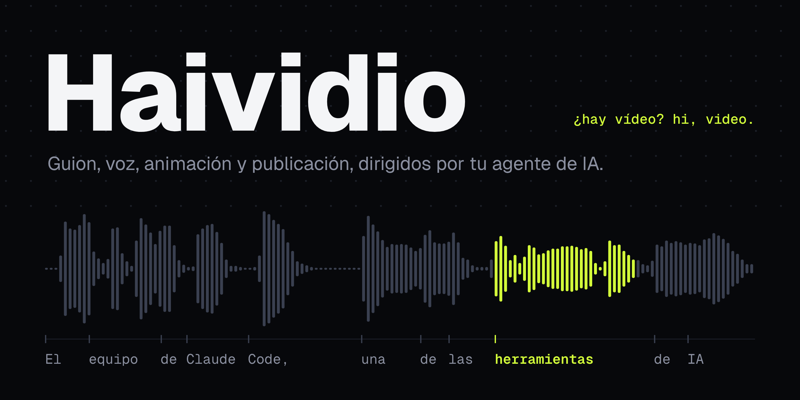

[Versión en español](README.md)

A manual and a workspace for making videos with AI agents. Open the terminal here and the agent already knows which tool to use, how the work is done and what failed last time.

*Haividio* sounds like «hay vídeo» ("there's video") in Spanish and like "hi, video" in English.

**[haividio.dev](https://haividio.dev/en/)** · [Pick your video](#pick-your-video) · [Get started](#get-started) · [Skills](#skills) · [Guides](#guides) · [Contributing](#contributing)

> **Language.** The guides, skills and memory are in Spanish today. Your agent reads them without trouble and answers in whatever language you write to it. English versions of the guides are welcome: see [Contributing](#contributing).

## Pick your video

| You want to make | With | Guide |
|---|---|---|
| Talking-head video: remove silences, mistakes and filler words | [video-use](https://github.com/browser-use/video-use) | [Workflow 1](docs/workflows/01-talking-video.en.md) |
| Animations over your explanation | video-use + HyperFrames or Remotion | [Workflow 2](docs/workflows/02-animations.en.md) |
| Faceless explainer with voice-over | [HyperFrames](https://github.com/heygen-com/hyperframes) or [Remotion](https://www.remotion.dev/docs/ai/skills) + ElevenLabs | [Workflow 3](docs/workflows/03-faceless-video.en.md) |
| Product demo: screen recording and cloned voice | Playwright + ffmpeg + HyperFrames | [Workflow 5](docs/workflows/05-product-demo.en.md) |
| Animate frames designed in Pencil | [Pencil](https://pen.dev) + HyperFrames | [Workflow 6](docs/workflows/06-pencil-to-hyperframes.en.md) |
| Publish to YouTube | [youtubeuploader](https://github.com/porjo/youtubeuploader) (YouTube Data API v3) | [Workflow 4](docs/workflows/04-publish-youtube.en.md) |

It works with Claude Code, Codex, OpenCode, pi and Cursor. The only paid service is ElevenLabs.

## Get started

```bash
git clone https://github.com/SantipBarber/haividio.git
cd haividio
claude    # or codex, opencode, pi, Cursor…
```

Your agent reads `AGENTS.md` and finds the skills (in `.agents/skills`, or `.claude/skills` in Claude Code): there is nothing else to install. Tell it what video you want; it picks the workflow and proposes a plan before rendering anything.

To use the skills in other projects (Claude Code plugin, `pi install` or `~/.agents/skills`) and to see what has been tested with each agent: [docs/other-agents.en.md](docs/other-agents.en.md).

Keys (ElevenLabs, Google) go in a `.env` at the root; it is in `.gitignore`. Heavy video and audio files are not committed.

<details>
<summary>Full install on Mac</summary>

```bash
# 1. Base tools
brew install ffmpeg node        # Node 22 or later
git clone https://github.com/SantipBarber/haividio.git
cd haividio

# 2. Check that the sample scene renders
cd videos/2026-10-31-rag-2026/animations/scene-03
npx hyperframes check
npx hyperframes preview          # preview in the browser
npx hyperframes render -o ~/Desktop/scene-03.mp4

# 3. Open your agent at the root of the repository
cd ../../../.. && claude          # or codex, opencode, pi
```

</details>

<details>
<summary>Full install on Windows</summary>

```powershell
# 1. Base tools (PowerShell)
winget install Git.Git
winget install GitHub.GitLFS
winget install OpenJS.NodeJS.LTS   # Node 22 or later
winget install Gyan.FFmpeg
winget install Python.Python.3.12
# close and reopen PowerShell so PATH is updated
git lfs install
git clone https://github.com/SantipBarber/haividio.git
cd haividio

# 2. Check that the sample scene renders
cd videos/2026-10-31-rag-2026/animations/scene-03
npx hyperframes check
npx hyperframes preview          # preview in Chrome or Edge
npx hyperframes render -o $HOME\Desktop\scene-03.mp4
```

The core is cross-platform, but HyperFrames on Windows is still untested and some tools are macOS-only. The rest is in [docs/windows.en.md](docs/windows.en.md).

</details>

## Skills

They have English names and trigger whether you ask in English or in Spanish; the agent replies in your language. If you linked them by hand before 0.2.0, link them again: they used to have Spanish names.

| Skill | What for |
|---|---|
| `choose-video-tool` | Picks the tool for the kind of video |
| `talking-video` | Edits takes: cuts, subtitles and synced animations |
| `faceless-video` | Research, script, voice, animation and render |
| `visual-identity` | Applies the channel's visual identity and avoids generic looks |
| `publish-youtube` | Title, chapters, thumbnail and upload as private |

## Guides

- [Cloned voice](docs/cloned-voice.en.md): models, pronunciation, takes and splicing.
- [Editing and checks](docs/editing-and-verification.en.md): sync, clean cuts, mixing and what each check proves.
- [Other agents](docs/other-agents.en.md): Codex, OpenCode, pi and Cursor, inside and outside the repository.
- [Tool catalogue](docs/tools.en.md): editors, MCP servers and skills, with their cost.
- [Visual identity](docs/style/identity.en.md): palette, typography and motion.
- [Open resources](docs/open-resources.en.md): docs, icons, fonts and audio, with their licenses.
- [Memory](memory/): lessons and failures, dated.

## Contributing

Tests and lessons with tools, agents and systems are the most welcome, in Spanish or English. Read [CONTRIBUTING.en.md](CONTRIBUTING.en.md) before opening a PR. Everyone who takes part accepts the [code of conduct](CODE_OF_CONDUCT.en.md).

## License

[MIT](LICENSE). The website uses the Geist typeface, under the SIL OFL. The tools and services mentioned have their own licenses.
